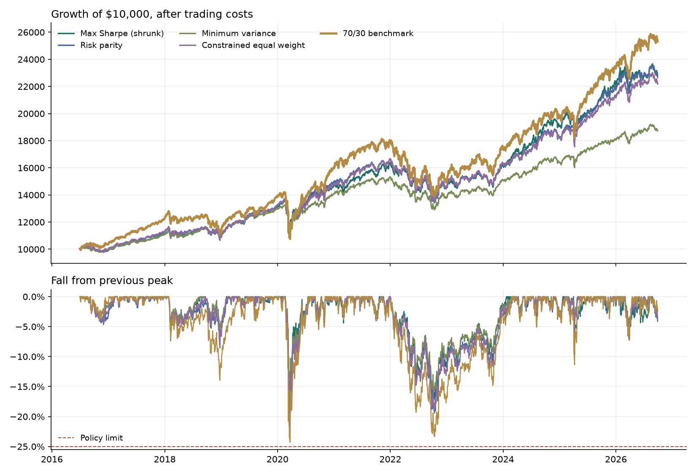

# Rivera Portfolio Lab

By Antonino Casabianca

Can a fictional 34-year-old retire at 55 without ever watching her savings fall more than 25%?

This project answers that with a walk-forward backtest of four ETF allocation strategies, all held to a written Investment Policy Statement (IPS), and a Monte Carlo projection that turns each strategy's results into a probability of reaching her goal. An interactive Streamlit dashboard lets you change any assumption and see the effect immediately.

Educational project, not investment advice.

## The client

Maya Rivera (fictional) is 34, has $85,000 invested, saves $2,200 a month, and wants $1,000,000 in today's dollars by 55. She has said she would abandon any plan that falls more than 25% from its peak.

| Rule | Limit |
| --- | --- |
| Instruments | ETFs with expense ratios of 0.25% or less |
| Direction | Long only, no shorting or leverage |
| Single holding | At most 25% |
| Stocks | 50% to 85% |
| Bonds | At least 10% |
| Real estate and gold | At most 20% combined |
| Worst fall from a peak | 25% (hard limit) |
| Rebalancing | Quarterly |
| Benchmark | 70% VT / 30% BND |

## Universe

Ten ETFs across three asset classes, each with history back to mid-2013:

- **Stocks:** VTI (US total market), VXUS (international), VIG (dividend growers), USMV (minimum volatility)
- **Bonds:** BND (US aggregate), BNDX (international, hedged), TIP (inflation-protected), SHY (1-3 year Treasuries)
- **Real assets:** VNQ (real estate), IAU (gold)

BIL (T-bills) is downloaded as the risk-free rate, so Sharpe ratios use actual cash yields instead of a fixed guess.

## Method

1. **Walk-forward testing.** At each quarterly rebalance, a strategy sees only the previous three years of prices, sets weights, and holds them while they drift with the market. It never sees the future.
2. **Four strategies**, all solved under every IPS rule:
   - *Max Sharpe (shrunk):* best return per unit of risk, with Ledoit-Wolf covariance shrinkage, expected returns pulled toward their average, and a 14% volatility cap. These fixes target the classic flaw of max-Sharpe optimizers, which pile into whatever did best recently.
   - *Risk parity:* spreads risk contributions as evenly as the rules allow.
   - *Minimum variance:* the smoothest ride the rules allow.
   - *Constrained equal weight:* as close to 1/N as the rules allow, the baseline every clever method must beat.
3. **Trading costs.** Every trade pays 5 basis points, including the initial purchase. The benchmark is rebalanced on the same dates and pays the same costs.
4. **Retirement projection.** 5,000 futures are built by stitching together random 12-month blocks of each strategy's out-of-sample returns, converted to today's dollars and reduced by a 1% yearly haircut, because backtests usually flatter a strategy. Because final wealth is linear in the monthly contribution, the dashboard also solves exactly for the saving rate needed for 80% or 90% confidence.

## Results

Out-of-sample period: July 2016 to September 2026. All numbers are after trading costs.

| Measure | Risk parity | 70/30 benchmark |
| --- | --- | --- |
| Annual return | 8.3% | 9.5% |
| Volatility | 9.7% | 12.2% |
| Sharpe ratio | 0.65 | 0.63 |
| Worst fall from a peak | -20.3% | -24.3% |

| Market shock | Risk parity | 70/30 benchmark |
| --- | --- | --- |
| Q4 2018 sell-off | -7.5% | -11.5% |
| COVID crash (2020) | -20.2% | -24.0% |
| 2022 rate shock | -19.1% | -22.5% |
| 2025 tariff shock | -6.6% | -11.4% |



**My recommendation for Maya is risk parity.** It earned about 1.2% a year less than the 70/30 benchmark, but it was noticeably less bumpy and lost less in every one of the four market shocks. Most importantly, its worst fall was 20.3%, which stays inside Maya's 25% limit. The benchmark fell about 24%, uncomfortably close to the point where she said she'd give up on the plan. A strategy she actually sticks with beats a slightly better one she abandons in a crash.

The Monte Carlo projection backs this up. Saving $2,200 a month with risk parity, 81% of 5,000 simulated futures reach her $1 million goal (in today's dollars) by 55, even after I cut the expected returns by 1% a year to be conservative.

All four strategies followed every rule in her policy. Minimum variance held up even better during the crashes, so it would be a reasonable choice if Maya cared about smoothness above everything else. The benchmark's higher return mostly reflects a very strong decade for US stocks, which may not repeat.

## Dashboard

`streamlit run dashboard.py` opens a dashboard with:

- **The answer up front:** Maya's probability of reaching her goal under the selected strategy, and the monthly saving needed for 80% confidence
- **Performance:** growth of $10,000, drawdowns against the policy limit, calendar-year returns, and a monthly returns heatmap
- **Compare strategies:** every strategy on the same dates, a return-against-risk chart, and a scorecard with Sharpe, Sortino, Calmar, capture ratios, and costs
- **Risk:** four stress tests (Q4 2018, COVID, 2022, 2025 tariffs), rolling volatility and Sharpe, a correlation matrix, and how much of the risk each fund contributes compared with how much money it holds
- **Holdings:** current weights, weights over time, turnover, and the fund menu
- **Retirement outlook:** a fan chart of 5,000 simulated futures by age, the spread of final outcomes, and required saving rates
- **Policy check:** every IPS rule, checked for every strategy

The sidebar changes the strategy, lookback window, rebalancing frequency, trading costs, volatility cap, position limit, return shrinkage, and all of Maya's plan inputs. Results update live.

## How to run

```
pip install -r requirements.txt
python data_pull.py          # real prices from Yahoo Finance
python run_backtest.py       # prints the scorecard, saves CSVs and backtest.png
streamlit run dashboard.py
```

No internet? `python data_pull.py --demo` creates simulated prices so everything still runs. The dashboard shows a clear warning while demo data is in use.

## Deploying the dashboard

1. Run `python data_pull.py` locally so `data/prices.csv` holds real prices.
2. Push the whole folder to GitHub, including `data/prices.csv` and `.streamlit/config.toml`.
3. On [share.streamlit.io](https://share.streamlit.io), create an app from the repo with `dashboard.py` as the main file.

## Files

| File | What it does |
| --- | --- |
| `engine.py` | Universe, IPS, strategies, walk-forward backtest, statistics, and Monte Carlo. No downloading or charting, so it is easy to test |
| `data_pull.py` | Downloads prices (or simulates them with `--demo`) to `data/prices.csv` |
| `run_backtest.py` | Runs everything from the command line, prints results, and saves CSVs and a chart |
| `dashboard.py` | The interactive Streamlit dashboard |
| `.streamlit/config.toml` | Dashboard theme |

## Limitations

- Taxes, bid-ask spreads beyond the flat cost, and investor behavior are not modeled.
- About ten years of out-of-sample results is a short sample, and it was a strong decade for US stocks, which favors the stock-heavy benchmark.
- The Monte Carlo can only reshuffle history. It cannot produce a crisis worse than the ones in the data.
- Quarterly rebalancing checks the weight rules at each rebalance; weights can drift past them in between, as in a real account.

## Next steps

- Add a tax-aware version with taxable and retirement accounts
- Try a drawdown-control overlay that shifts toward SHY after large falls
- Compare against a target-date fund as a second benchmark
